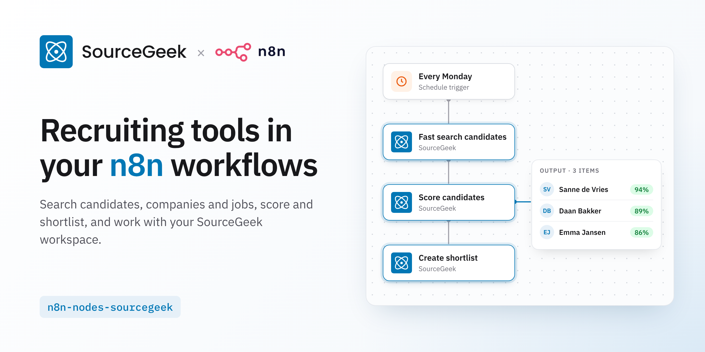

# SourceGeek n8n node

This is an n8n community node. It lets you use SourceGeek's tools in your n8n workflows: the same tools SourceGeek's chat agent and its Claude connector use.

[n8n](https://n8n.io/) is a [fair-code licensed](https://docs.n8n.io/reference/license/) workflow automation platform.

[Installation](#installation)  
[Operations](#operations)  
[Credentials](#credentials)  
[Compatibility](#compatibility)  
[Development](#development)  
[Resources](#resources)

## Installation

Follow the [installation guide](https://docs.n8n.io/integrations/community-nodes/installation/) in the n8n community nodes documentation.

## Operations

One action per SourceGeek tool, grouped by resource:

* **Search**: fast and precision searches for candidates, companies and jobs, entity enrichment, rediscovered talent
* **Employee Data**: public profiles, companies, jobs, posts, comments and reactions, contact details
* **Sheet and Shortlist**: create and read sheets, score candidates, create shortlists, read shortlist feedback
* **Project**: list projects and tasks, plan and start tasks, read task results
* **Memory and Workspace Context**: remember, forget and list memories; read and update workspace context
* **Occupation and Skill (ESCO)** and **Labour Market Statistics (CBS)**

Each action's fields come from the tool's input schema: required inputs are fields, optional ones are under **Additional Fields**. An action returns the tool's result as the item's JSON. Tools that spend SourceGeek credits spend the workspace's credits, as in the chat.

## Credentials

1. Sign in to SourceGeek at [chat.sourcegeek.com](https://chat.sourcegeek.com).
2. Open **Settings → Connected apps**, and under **API keys** click **Create API key**.
3. Copy the key (it is shown once) and paste it into the **API Key** field of the **SourceGeek API** credential in n8n.

The key acts as you in that workspace. Revoke it under **Settings → Connected apps** to cut n8n off. Leave **Base URL** as `https://chat.sourcegeek.com`.

## Compatibility

* Requires an n8n version with community node support (tested against 1.112).
* Version 2 of the node replaces version 1's actions and its API keys, which worked with the old SourceGeek app.

## Development

The actions are built from `nodes/SourceGeek/tools.json`, a snapshot of SourceGeek's tool catalog (`GET /api/v1/tools`). Refresh it when SourceGeek's tools change:

```bash
SOURCEGEEK_API_KEY=sgk_... npm run sync-tools
npm run build && npm run lint
```

## Resources

* [n8n community nodes documentation](https://docs.n8n.io/integrations/#community-nodes)
* [SourceGeek support](https://support.sourcegeek.com)